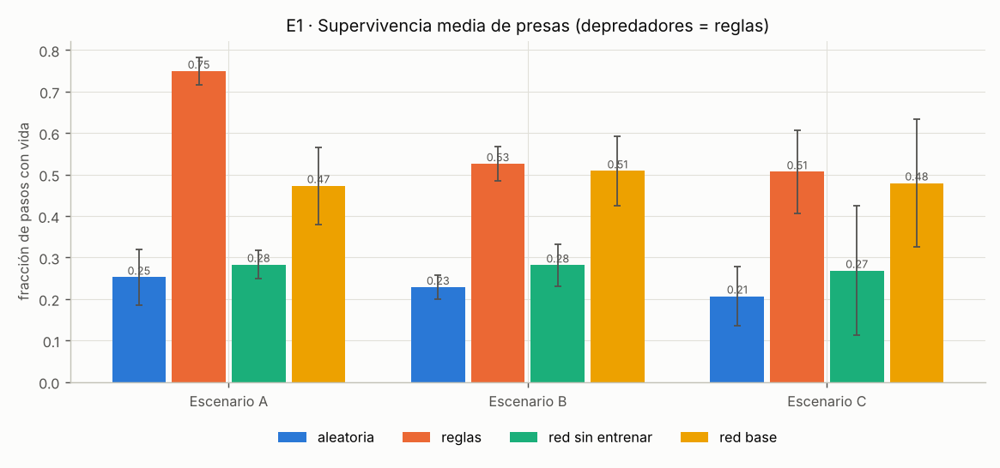
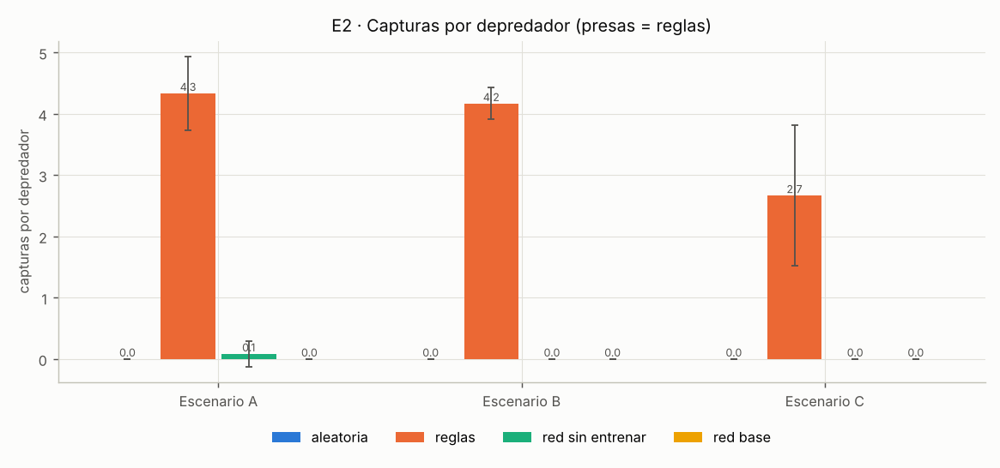

# Resultados experimentales — NeuroEcosistema

_Archivo generado automáticamente por `evaluar.py`. No editar a mano; volver a ejecutar._

- Semillas de evaluación: `[1000, 1001, 1002, 1003, 1004, 1005]` (6 repeticiones por celda)
- Modelos: `/tmp/modmed`
- Escenarios:
  - **A** — Recursos suficientes, pocos depredadores: 20 presas, 2 depredadores, 45 plantas (regeneran en 50 pasos), 0 obstáculos, 400 pasos máx.
  - **B** — Escasez de alimento: 20 presas, 2 depredadores, 12 plantas (regeneran en 140 pasos), 0 obstáculos, 400 pasos máx.
  - **C** — Alta presión de depredación + obstáculos: 20 presas, 5 depredadores, 35 plantas (regeneran en 60 pasos), 6 obstáculos, 400 pasos máx.

Formato de celdas: media ± desviación estándar entre semillas. `—` = no ocurrió (p. ej. sin capturas).

## E1 — Presas (depredadores fijos = reglas)

Variable independiente: política de las presas. Controladas: escenario, semillas, depredadores por reglas.

| Escenario | Política | supervivencia_presas | presas_vivas_final | comida_por_presa | muertes_hambre_presas | capturas | tiempo_medio_captura |
|---|---|---|---|---|---|---|---|
| A | aleatoria | 0.25 ± 0.07 | 0.01 ± 0.02 | 0.56 ± 0.19 | 1.00 ± 1.26 | 18.83 ± 1.47 | 94.74 ± 17.65 |
| A | reglas | 0.75 ± 0.03 | 0.54 ± 0.07 | 10.28 ± 0.66 | 0.50 ± 0.55 | 8.67 ± 1.21 | 181.21 ± 21.61 |
| A | red sin entrenar | 0.28 ± 0.03 | 0.00 ± 0.00 | 0.43 ± 0.16 | 4.67 ± 3.20 | 15.33 ± 3.20 | 86.62 ± 11.09 |
| A | red base | 0.47 ± 0.09 | 0.14 ± 0.09 | 0.38 ± 0.12 | 1.17 ± 1.94 | 16.00 ± 2.76 | 149.19 ± 26.90 |
| B | aleatoria | 0.23 ± 0.03 | 0.00 ± 0.00 | 0.14 ± 0.04 | 3.67 ± 2.94 | 16.33 ± 2.94 | 67.39 ± 13.84 |
| B | reglas | 0.53 ± 0.04 | 0.09 ± 0.04 | 1.41 ± 0.16 | 9.83 ± 0.75 | 8.33 ± 0.52 | 158.66 ± 22.55 |
| B | red sin entrenar | 0.28 ± 0.05 | 0.01 ± 0.02 | 0.10 ± 0.09 | 3.50 ± 4.09 | 16.33 ± 4.08 | 90.21 ± 35.90 |
| B | red base | 0.51 ± 0.08 | 0.25 ± 0.16 | 0.12 ± 0.10 | 0.83 ± 1.17 | 14.17 ± 3.49 | 117.60 ± 44.18 |
| C | aleatoria | 0.21 ± 0.07 | 0.00 ± 0.00 | 0.27 ± 0.12 | 3.17 ± 2.64 | 16.83 ± 2.64 | 62.44 ± 16.73 |
| C | reglas | 0.51 ± 0.10 | 0.13 ± 0.13 | 3.51 ± 1.74 | 4.00 ± 4.82 | 13.33 ± 5.72 | 144.72 ± 18.97 |
| C | red sin entrenar | 0.27 ± 0.16 | 0.02 ± 0.03 | 0.27 ± 0.22 | 2.83 ± 2.04 | 16.83 ± 2.40 | 92.81 ± 67.08 |
| C | red base | 0.48 ± 0.15 | 0.25 ± 0.22 | 0.16 ± 0.06 | 2.33 ± 1.51 | 12.67 ± 4.23 | 85.59 ± 82.96 |

### Antes vs después del entrenamiento (supervivencia de presas)

| Escenario | red base | red sin entrenar | Diferencia | t de Welch | p aprox. |
|---|---|---|---|---|---|
| A | 0.473 | 0.283 | +0.190 | 4.69 | 2.68e-06 |
| B | 0.509 | 0.282 | +0.227 | 5.67 | 1.45e-08 |
| C | 0.479 | 0.268 | +0.211 | 2.35 | 0.0186 |

### Red entrenada vs referencia por reglas (supervivencia de presas)

| Escenario | red base | reglas | Diferencia | t de Welch | p aprox. |
|---|---|---|---|---|---|
| A | 0.473 | 0.749 | -0.276 | -6.83 | 8.36e-12 |
| B | 0.509 | 0.526 | -0.017 | -0.45 | 0.65 |
| C | 0.479 | 0.506 | -0.027 | -0.36 | 0.718 |

### Red entrenada vs referencia aleatoria (supervivencia de presas)

| Escenario | red base | aleatoria | Diferencia | t de Welch | p aprox. |
|---|---|---|---|---|---|
| A | 0.473 | 0.252 | +0.221 | 4.73 | 2.27e-06 |
| B | 0.509 | 0.228 | +0.280 | 7.76 | 8.7e-15 |
| C | 0.479 | 0.207 | +0.273 | 3.91 | 9.07e-05 |

### Arquitectura base vs pequeña (supervivencia de presas)

| Escenario | red base | red pequeña | Diferencia | t de Welch | p aprox. |
|---|---|---|---|---|---|

## E2 — Depredadores (presas fijas = reglas)

Variable independiente: política de los depredadores. Controladas: escenario, semillas, presas por reglas.

| Escenario | Política | capturas_por_depredador | energia_final_depredadores | depredadores_vivos_final | tiempo_primera_captura | tiempo_medio_captura |
|---|---|---|---|---|---|---|
| A | aleatoria | 0.00 ± 0.00 | 0.00 ± 0.00 | 0.00 ± 0.00 | — | — |
| A | reglas | 4.33 ± 0.61 | 0.42 ± 0.14 | 0.92 ± 0.20 | 37.00 ± 8.15 | 181.21 ± 21.61 |
| A | red sin entrenar | 0.08 ± 0.20 | 0.00 ± 0.00 | 0.00 ± 0.00 | 67.00 ± 0.00 | 67.00 ± 0.00 |
| A | red base | 0.00 ± 0.00 | 0.00 ± 0.00 | 0.00 ± 0.00 | — | — |
| B | aleatoria | 0.00 ± 0.00 | 0.00 ± 0.00 | 0.00 ± 0.00 | — | — |
| B | reglas | 4.17 ± 0.26 | 0.30 ± 0.14 | 0.83 ± 0.26 | 63.00 ± 24.07 | 158.66 ± 22.55 |
| B | red sin entrenar | 0.00 ± 0.00 | 0.00 ± 0.00 | 0.00 ± 0.00 | — | — |
| B | red base | 0.00 ± 0.00 | 0.02 ± 0.04 | 0.17 ± 0.41 | — | — |
| C | aleatoria | 0.00 ± 0.00 | 0.00 ± 0.00 | 0.00 ± 0.00 | — | — |
| C | reglas | 2.67 ± 1.14 | 0.22 ± 0.15 | 0.43 ± 0.29 | 11.67 ± 9.29 | 144.72 ± 18.97 |
| C | red sin entrenar | 0.00 ± 0.00 | 0.00 ± 0.00 | 0.00 ± 0.00 | — | — |
| C | red base | 0.00 ± 0.00 | 0.00 ± 0.00 | 0.00 ± 0.00 | — | — |

### Antes vs después del entrenamiento (capturas por depredador)

| Escenario | red base | red sin entrenar | Diferencia | t de Welch | p aprox. |
|---|---|---|---|---|---|
| A | 0.000 | 0.083 | -0.083 | -1.00 | 0.317 |
| B | 0.000 | 0.000 | +0.000 | nan | nan |
| C | 0.000 | 0.000 | +0.000 | nan | nan |

### Red entrenada vs reglas (capturas por depredador)

| Escenario | red base | reglas | Diferencia | t de Welch | p aprox. |
|---|---|---|---|---|---|
| A | 0.000 | 4.333 | -4.333 | -17.53 | 8.58e-69 |
| B | 0.000 | 4.167 | -4.167 | -39.53 | 0 |
| C | 0.000 | 2.667 | -2.667 | -5.71 | 1.1e-08 |

### Arquitectura base vs pequeña (capturas por depredador)

| Escenario | red base | red pequeña | Diferencia | t de Welch | p aprox. |
|---|---|---|---|---|---|

## E3 — Ecosistema completo (ambas especies con la misma clase de política)

| Escenario | Política | supervivencia_presas | comida_consumida | capturas | energia_final_presas | energia_final_depredadores |
|---|---|---|---|---|---|---|
| A | redes sin entrenar | 0.70 ± 0.08 | 7.17 ± 2.48 | 1.17 ± 1.17 | 0.12 ± 0.04 | 0.10 ± 0.17 |
| A | redes entrenadas | 0.95 ± 0.04 | 2.50 ± 1.05 | 0.00 ± 0.00 | 0.12 ± 0.02 | 0.00 ± 0.00 |
| A | reglas vs reglas | 0.75 ± 0.03 | 205.67 ± 13.25 | 8.67 ± 1.21 | 0.79 ± 0.06 | 0.42 ± 0.14 |
| B | redes sin entrenar | 0.71 ± 0.07 | 1.83 ± 0.98 | 0.17 ± 0.41 | 0.09 ± 0.03 | 0.02 ± 0.04 |
| B | redes entrenadas | 0.98 ± 0.02 | 1.50 ± 0.84 | 0.00 ± 0.00 | 0.11 ± 0.02 | 0.00 ± 0.00 |
| B | reglas vs reglas | 0.53 ± 0.04 | 28.17 ± 3.25 | 8.33 ± 0.52 | 0.72 ± 0.20 | 0.30 ± 0.14 |
| C | redes sin entrenar | 0.71 ± 0.07 | 6.67 ± 3.61 | 1.17 ± 1.33 | 0.14 ± 0.05 | 0.02 ± 0.03 |
| C | redes entrenadas | 0.89 ± 0.07 | 3.33 ± 1.75 | 0.33 ± 0.52 | 0.13 ± 0.03 | 0.01 ± 0.02 |
| C | reglas vs reglas | 0.51 ± 0.10 | 70.17 ± 34.76 | 13.33 ± 5.72 | 0.56 ± 0.31 | 0.22 ± 0.15 |

> p aprox. usa la aproximación normal de la t de Welch (n=10 por grupo); tómese como orientativo, no como prueba formal. Lo importante es el tamaño de la diferencia frente a la desviación estándar.
