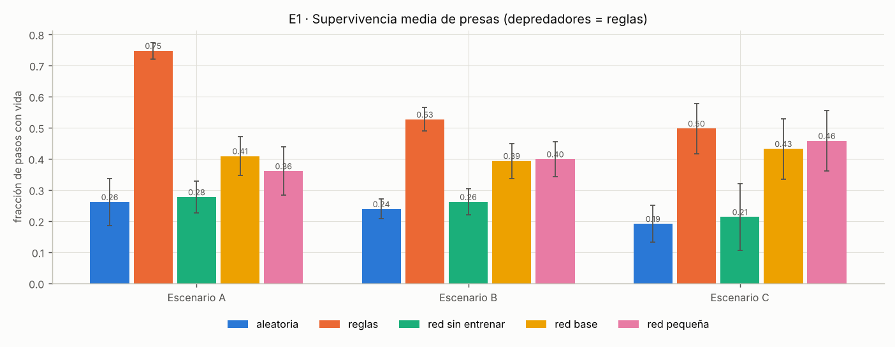
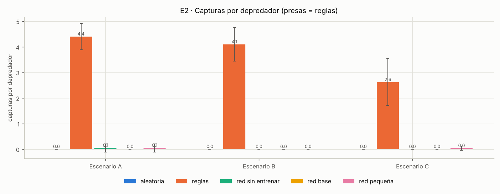
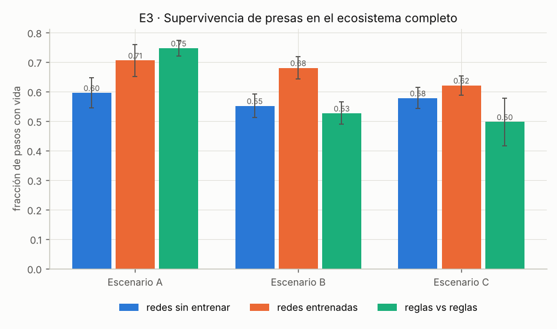

# Resultados experimentales — NeuroEcosistema

_Archivo generado automáticamente por `evaluar.py`. No editar a mano; volver a ejecutar._

- Semillas de evaluación: `[1000, 1001, 1002, 1003, 1004, 1005, 1006, 1007, 1008, 1009]` (10 repeticiones por celda)
- Modelos: `modelos`
- Escenarios:
  - **A** — Recursos suficientes, pocos depredadores: 20 presas, 2 depredadores, 45 plantas (regeneran en 50 pasos), 0 obstáculos, 400 pasos máx.
  - **B** — Escasez de alimento: 20 presas, 2 depredadores, 12 plantas (regeneran en 140 pasos), 0 obstáculos, 400 pasos máx.
  - **C** — Alta presión de depredación + obstáculos: 20 presas, 5 depredadores, 35 plantas (regeneran en 60 pasos), 6 obstáculos, 400 pasos máx.

Formato de celdas: media ± desviación estándar entre semillas. `—` = no ocurrió (p. ej. sin capturas).

## E1 — Presas (depredadores fijos = reglas)

Variable independiente: política de las presas. Controladas: escenario, semillas, depredadores por reglas.

| Escenario | Política | supervivencia_presas | presas_vivas_final | comida_por_presa | muertes_hambre_presas | capturas | tiempo_medio_captura |
|---|---|---|---|---|---|---|---|
| A | aleatoria | 0.26 ± 0.08 | 0.01 ± 0.02 | 0.51 ± 0.19 | 2.40 ± 2.95 | 17.50 ± 2.95 | 89.38 ± 20.16 |
| A | reglas | 0.75 ± 0.03 | 0.54 ± 0.07 | 10.55 ± 0.71 | 0.40 ± 0.52 | 8.80 ± 1.03 | 178.85 ± 19.47 |
| A | red sin entrenar | 0.28 ± 0.05 | 0.01 ± 0.02 | 0.40 ± 0.17 | 3.90 ± 3.18 | 16.00 ± 3.27 | 83.06 ± 19.56 |
| A | red base | 0.41 ± 0.06 | 0.03 ± 0.05 | 0.68 ± 0.17 | 4.00 ± 2.11 | 15.50 ± 2.95 | 127.83 ± 17.49 |
| A | red pequeña | 0.36 ± 0.08 | 0.01 ± 0.02 | 0.70 ± 0.17 | 3.10 ± 2.18 | 16.80 ± 2.20 | 120.53 ± 23.99 |
| B | aleatoria | 0.24 ± 0.03 | 0.00 ± 0.00 | 0.13 ± 0.06 | 4.00 ± 2.49 | 16.00 ± 2.49 | 72.75 ± 13.15 |
| B | reglas | 0.53 ± 0.04 | 0.09 ± 0.04 | 1.41 ± 0.14 | 10.00 ± 0.94 | 8.20 ± 1.32 | 156.27 ± 28.36 |
| B | red sin entrenar | 0.26 ± 0.04 | 0.00 ± 0.00 | 0.10 ± 0.07 | 3.10 ± 3.78 | 16.90 ± 3.78 | 83.83 ± 21.63 |
| B | red base | 0.39 ± 0.06 | 0.00 ± 0.00 | 0.18 ± 0.08 | 6.70 ± 3.13 | 13.30 ± 3.13 | 99.26 ± 27.56 |
| B | red pequeña | 0.40 ± 0.06 | 0.01 ± 0.02 | 0.18 ± 0.09 | 6.10 ± 2.73 | 13.80 ± 2.74 | 108.33 ± 25.26 |
| C | aleatoria | 0.19 ± 0.06 | 0.00 ± 0.00 | 0.26 ± 0.15 | 2.40 ± 2.27 | 17.60 ± 2.27 | 61.97 ± 16.43 |
| C | reglas | 0.50 ± 0.08 | 0.14 ± 0.11 | 3.08 ± 1.42 | 4.00 ± 3.80 | 13.10 ± 4.58 | 138.50 ± 22.31 |
| C | red sin entrenar | 0.21 ± 0.11 | 0.00 ± 0.00 | 0.21 ± 0.19 | 3.00 ± 3.89 | 17.00 ± 3.89 | 68.98 ± 29.63 |
| C | red base | 0.43 ± 0.10 | 0.03 ± 0.05 | 0.29 ± 0.10 | 12.30 ± 2.06 | 7.20 ± 2.62 | 37.89 ± 15.30 |
| C | red pequeña | 0.46 ± 0.10 | 0.04 ± 0.03 | 0.44 ± 0.15 | 9.30 ± 3.40 | 10.00 ± 3.86 | 82.55 ± 46.93 |

### Antes vs después del entrenamiento (supervivencia de presas)

| Escenario | red base | red sin entrenar | Diferencia | t de Welch | p aprox. |
|---|---|---|---|---|---|
| A | 0.408 | 0.277 | +0.132 | 5.21 | 1.9e-07 |
| B | 0.393 | 0.261 | +0.132 | 5.97 | 2.33e-09 |
| C | 0.432 | 0.213 | +0.219 | 4.78 | 1.75e-06 |

### Red entrenada vs referencia por reglas (supervivencia de presas)

| Escenario | red base | reglas | Diferencia | t de Welch | p aprox. |
|---|---|---|---|---|---|
| A | 0.408 | 0.747 | -0.338 | -15.88 | 8.44e-57 |
| B | 0.393 | 0.526 | -0.133 | -6.22 | 4.95e-10 |
| C | 0.432 | 0.497 | -0.065 | -1.63 | 0.103 |

### Red entrenada vs referencia aleatoria (supervivencia de presas)

| Escenario | red base | aleatoria | Diferencia | t de Welch | p aprox. |
|---|---|---|---|---|---|
| A | 0.408 | 0.261 | +0.148 | 4.77 | 1.83e-06 |
| B | 0.393 | 0.238 | +0.155 | 7.60 | 2.98e-14 |
| C | 0.432 | 0.191 | +0.241 | 6.70 | 2.15e-11 |

### Arquitectura base vs pequeña (supervivencia de presas)

| Escenario | red base | red pequeña | Diferencia | t de Welch | p aprox. |
|---|---|---|---|---|---|
| A | 0.408 | 0.360 | +0.048 | 1.54 | 0.122 |
| B | 0.393 | 0.399 | -0.005 | -0.22 | 0.829 |
| C | 0.432 | 0.458 | -0.026 | -0.59 | 0.554 |

## E2 — Depredadores (presas fijas = reglas)

Variable independiente: política de los depredadores. Controladas: escenario, semillas, presas por reglas.

| Escenario | Política | capturas_por_depredador | energia_final_depredadores | acercamiento_depredadores | depredadores_vivos_final | tiempo_primera_captura | tiempo_medio_captura |
|---|---|---|---|---|---|---|---|
| A | aleatoria | 0.00 ± 0.00 | 0.00 ± 0.00 | 0.22 ± 0.02 | 0.00 ± 0.00 | — | — |
| A | reglas | 4.40 ± 0.52 | 0.44 ± 0.12 | 0.65 ± 0.08 | 0.95 ± 0.16 | 40.20 ± 11.50 | 178.85 ± 19.47 |
| A | red sin entrenar | 0.05 ± 0.16 | 0.00 ± 0.00 | 0.22 ± 0.07 | 0.00 ± 0.00 | 55.00 ± 0.00 | 55.00 ± 0.00 |
| A | red base | 0.00 ± 0.00 | 0.00 ± 0.00 | 0.15 ± 0.07 | 0.00 ± 0.00 | — | — |
| A | red pequeña | 0.05 ± 0.16 | 0.00 ± 0.00 | 0.26 ± 0.05 | 0.00 ± 0.00 | 26.00 ± 0.00 | 26.00 ± 0.00 |
| B | aleatoria | 0.00 ± 0.00 | 0.00 ± 0.00 | 0.21 ± 0.02 | 0.00 ± 0.00 | — | — |
| B | reglas | 4.10 ± 0.66 | 0.33 ± 0.17 | 0.57 ± 0.04 | 0.85 ± 0.24 | 48.10 ± 26.93 | 156.27 ± 28.36 |
| B | red sin entrenar | 0.00 ± 0.00 | 0.00 ± 0.00 | 0.19 ± 0.07 | 0.00 ± 0.00 | — | — |
| B | red base | 0.00 ± 0.00 | 0.00 ± 0.00 | 0.14 ± 0.06 | 0.00 ± 0.00 | — | — |
| B | red pequeña | 0.00 ± 0.00 | 0.00 ± 0.00 | 0.25 ± 0.04 | 0.00 ± 0.00 | — | — |
| C | aleatoria | 0.00 ± 0.00 | 0.00 ± 0.00 | 0.18 ± 0.03 | 0.00 ± 0.00 | — | — |
| C | reglas | 2.62 ± 0.92 | 0.17 ± 0.14 | 0.52 ± 0.06 | 0.38 ± 0.26 | 13.90 ± 9.00 | 138.50 ± 22.31 |
| C | red sin entrenar | 0.00 ± 0.00 | 0.00 ± 0.00 | 0.18 ± 0.05 | 0.00 ± 0.00 | — | — |
| C | red base | 0.00 ± 0.00 | 0.00 ± 0.00 | 0.15 ± 0.06 | 0.00 ± 0.00 | — | — |
| C | red pequeña | 0.04 ± 0.08 | 0.00 ± 0.00 | 0.25 ± 0.04 | 0.00 ± 0.00 | 44.50 ± 2.12 | 44.50 ± 2.12 |

### Antes vs después del entrenamiento (capturas por depredador)

| Escenario | red base | red sin entrenar | Diferencia | t de Welch | p aprox. |
|---|---|---|---|---|---|
| A | 0.000 | 0.050 | -0.050 | -1.00 | 0.317 |
| B | 0.000 | 0.000 | +0.000 | nan | nan |
| C | 0.000 | 0.000 | +0.000 | nan | nan |

### Red entrenada vs reglas (capturas por depredador)

| Escenario | red base | reglas | Diferencia | t de Welch | p aprox. |
|---|---|---|---|---|---|
| A | 0.000 | 4.400 | -4.400 | -26.94 | 6.64e-160 |
| B | 0.000 | 4.100 | -4.100 | -19.70 | 2.34e-86 |
| C | 0.000 | 2.620 | -2.620 | -9.04 | 1.53e-19 |

### Arquitectura base vs pequeña (capturas por depredador)

| Escenario | red base | red pequeña | Diferencia | t de Welch | p aprox. |
|---|---|---|---|---|---|
| A | 0.000 | 0.050 | -0.050 | -1.00 | 0.317 |
| B | 0.000 | 0.000 | +0.000 | nan | nan |
| C | 0.000 | 0.040 | -0.040 | -1.50 | 0.134 |

## E3 — Ecosistema completo (ambas especies con la misma clase de política)

| Escenario | Política | supervivencia_presas | comida_consumida | capturas | energia_final_presas | energia_final_depredadores |
|---|---|---|---|---|---|---|
| A | redes sin entrenar | 0.60 ± 0.05 | 8.70 ± 3.62 | 1.20 ± 1.32 | 0.15 ± 0.15 | 0.04 ± 0.05 |
| A | redes entrenadas | 0.71 ± 0.05 | 10.20 ± 2.74 | 1.70 ± 1.25 | 0.15 ± 0.11 | 0.00 ± 0.00 |
| A | reglas vs reglas | 0.75 ± 0.03 | 211.00 ± 14.20 | 8.80 ± 1.03 | 0.81 ± 0.06 | 0.44 ± 0.12 |
| B | redes sin entrenar | 0.55 ± 0.04 | 2.10 ± 1.29 | 0.50 ± 0.71 | 0.00 ± 0.00 | 0.03 ± 0.04 |
| B | redes entrenadas | 0.68 ± 0.04 | 3.20 ± 1.48 | 1.00 ± 1.15 | 0.06 ± 0.09 | 0.00 ± 0.00 |
| B | reglas vs reglas | 0.53 ± 0.04 | 28.20 ± 2.74 | 8.20 ± 1.32 | 0.68 ± 0.20 | 0.33 ± 0.17 |
| C | redes sin entrenar | 0.58 ± 0.04 | 5.70 ± 3.33 | 1.20 ± 1.03 | 0.04 ± 0.09 | 0.01 ± 0.03 |
| C | redes entrenadas | 0.62 ± 0.03 | 6.50 ± 3.66 | 2.40 ± 1.43 | 0.01 ± 0.02 | 0.00 ± 0.00 |
| C | reglas vs reglas | 0.50 ± 0.08 | 61.50 ± 28.39 | 13.10 ± 4.58 | 0.57 ± 0.28 | 0.17 ± 0.14 |

> p aprox. usa la aproximación normal de la t de Welch (n=10 por grupo); tómese como orientativo, no como prueba formal. Lo importante es el tamaño de la diferencia frente a la desviación estándar.
