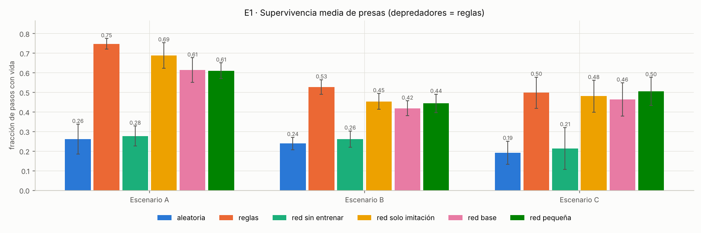
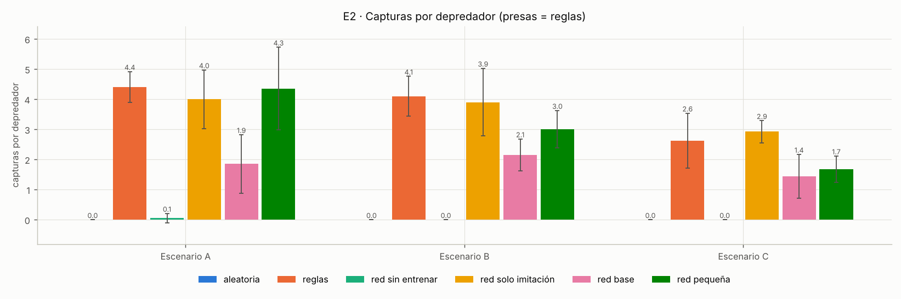
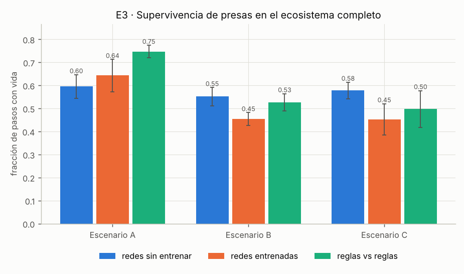

# Resultados experimentales — NeuroEcosistema

_Archivo generado automáticamente por `evaluar.py`. No editar a mano; volver a ejecutar._

- Semillas de evaluación: `[1000, 1001, 1002, 1003, 1004, 1005, 1006, 1007, 1008, 1009]` (10 repeticiones por celda)
- Modelos: `modelos`
- Escenarios:
  - **A** — Recursos suficientes, pocos depredadores: 20 presas, 2 depredadores, 45 plantas (regeneran en 50 pasos), 0 obstáculos, 400 pasos máx.
  - **B** — Escasez de alimento: 20 presas, 2 depredadores, 12 plantas (regeneran en 140 pasos), 0 obstáculos, 400 pasos máx.
  - **C** — Alta presión de depredación + obstáculos: 20 presas, 5 depredadores, 35 plantas (regeneran en 60 pasos), 6 obstáculos, 400 pasos máx.

Formato de celdas: media ± desviación estándar entre semillas. `—` = no ocurrió (p. ej. sin capturas).

## E1 — Presas (depredadores fijos = reglas)

Variable independiente: política de las presas. Controladas: escenario, semillas, depredadores por reglas.

| Escenario | Política | supervivencia_presas | presas_vivas_final | comida_por_presa | muertes_hambre_presas | capturas | tiempo_medio_captura |
|---|---|---|---|---|---|---|---|
| A | aleatoria | 0.26 ± 0.08 | 0.01 ± 0.02 | 0.51 ± 0.19 | 2.40 ± 2.95 | 17.50 ± 2.95 | 89.38 ± 20.16 |
| A | reglas | 0.75 ± 0.03 | 0.54 ± 0.07 | 10.55 ± 0.71 | 0.40 ± 0.52 | 8.80 ± 1.03 | 178.85 ± 19.47 |
| A | red sin entrenar | 0.28 ± 0.05 | 0.01 ± 0.02 | 0.40 ± 0.17 | 3.90 ± 3.18 | 16.00 ± 3.27 | 83.06 ± 19.56 |
| A | red solo imitación | 0.69 ± 0.07 | 0.38 ± 0.12 | 7.96 ± 0.82 | 1.50 ± 1.72 | 11.00 ± 3.40 | 185.76 ± 26.69 |
| A | red base | 0.61 ± 0.06 | 0.20 ± 0.10 | 3.24 ± 0.62 | 5.20 ± 2.94 | 10.90 ± 3.93 | 169.59 ± 30.81 |
| A | red pequeña | 0.61 ± 0.04 | 0.25 ± 0.11 | 4.37 ± 0.46 | 2.10 ± 1.97 | 12.90 ± 2.28 | 164.57 ± 38.15 |
| B | aleatoria | 0.24 ± 0.03 | 0.00 ± 0.00 | 0.13 ± 0.06 | 4.00 ± 2.49 | 16.00 ± 2.49 | 72.75 ± 13.15 |
| B | reglas | 0.53 ± 0.04 | 0.09 ± 0.04 | 1.41 ± 0.14 | 10.00 ± 0.94 | 8.20 ± 1.32 | 156.27 ± 28.36 |
| B | red sin entrenar | 0.26 ± 0.04 | 0.00 ± 0.00 | 0.10 ± 0.07 | 3.10 ± 3.78 | 16.90 ± 3.78 | 83.83 ± 21.63 |
| B | red solo imitación | 0.45 ± 0.04 | 0.04 ± 0.03 | 0.82 ± 0.19 | 11.30 ± 2.83 | 8.00 ± 2.91 | 116.33 ± 19.62 |
| B | red base | 0.42 ± 0.04 | 0.01 ± 0.02 | 0.59 ± 0.10 | 10.70 ± 3.89 | 9.10 ± 3.75 | 107.92 ± 25.06 |
| B | red pequeña | 0.44 ± 0.05 | 0.04 ± 0.06 | 0.78 ± 0.16 | 10.80 ± 3.16 | 8.40 ± 3.47 | 105.00 ± 33.87 |
| C | aleatoria | 0.19 ± 0.06 | 0.00 ± 0.00 | 0.26 ± 0.15 | 2.40 ± 2.27 | 17.60 ± 2.27 | 61.97 ± 16.43 |
| C | reglas | 0.50 ± 0.08 | 0.14 ± 0.11 | 3.08 ± 1.42 | 4.00 ± 3.80 | 13.10 ± 4.58 | 138.50 ± 22.31 |
| C | red sin entrenar | 0.21 ± 0.11 | 0.00 ± 0.00 | 0.21 ± 0.19 | 3.00 ± 3.89 | 17.00 ± 3.89 | 68.98 ± 29.63 |
| C | red solo imitación | 0.48 ± 0.08 | 0.07 ± 0.08 | 1.78 ± 0.55 | 9.30 ± 3.62 | 9.20 ± 3.39 | 101.38 ± 25.86 |
| C | red base | 0.46 ± 0.09 | 0.08 ± 0.05 | 1.38 ± 0.43 | 9.30 ± 3.97 | 9.20 ± 4.32 | 84.37 ± 42.27 |
| C | red pequeña | 0.50 ± 0.07 | 0.20 ± 0.12 | 2.37 ± 0.68 | 5.20 ± 5.18 | 10.90 ± 4.95 | 102.27 ± 40.66 |

### Antes vs después del entrenamiento (supervivencia de presas)

| Escenario | red base | red sin entrenar | Diferencia | t de Welch | p aprox. |
|---|---|---|---|---|---|
| A | 0.613 | 0.277 | +0.337 | 13.20 | 8.7e-40 |
| B | 0.418 | 0.261 | +0.156 | 8.76 | 2.03e-18 |
| C | 0.463 | 0.213 | +0.250 | 5.75 | 8.94e-09 |

### Efecto de la neuroevolución tras la imitación (supervivencia de presas)

| Escenario | red base | red solo imitación | Diferencia | t de Welch | p aprox. |
|---|---|---|---|---|---|
| A | 0.613 | 0.688 | -0.074 | -2.59 | 0.00949 |
| B | 0.418 | 0.453 | -0.036 | -2.03 | 0.0425 |
| C | 0.463 | 0.480 | -0.017 | -0.46 | 0.648 |

### Red entrenada vs referencia por reglas (supervivencia de presas)

| Escenario | red base | reglas | Diferencia | t de Welch | p aprox. |
|---|---|---|---|---|---|
| A | 0.613 | 0.747 | -0.133 | -6.19 | 6.08e-10 |
| B | 0.418 | 0.526 | -0.109 | -6.39 | 1.7e-10 |
| C | 0.463 | 0.497 | -0.034 | -0.92 | 0.356 |

### Red entrenada vs referencia aleatoria (supervivencia de presas)

| Escenario | red base | aleatoria | Diferencia | t de Welch | p aprox. |
|---|---|---|---|---|---|
| A | 0.613 | 0.261 | +0.353 | 11.34 | 8.32e-30 |
| B | 0.418 | 0.238 | +0.179 | 11.41 | 3.74e-30 |
| C | 0.463 | 0.191 | +0.272 | 8.25 | 1.52e-16 |

### Arquitectura base vs pequeña (supervivencia de presas)

| Escenario | red base | red pequeña | Diferencia | t de Welch | p aprox. |
|---|---|---|---|---|---|
| A | 0.613 | 0.610 | +0.004 | 0.16 | 0.872 |
| B | 0.418 | 0.443 | -0.026 | -1.33 | 0.183 |
| C | 0.463 | 0.504 | -0.041 | -1.16 | 0.246 |

## E2 — Depredadores (presas fijas = reglas)

Variable independiente: política de los depredadores. Controladas: escenario, semillas, presas por reglas.

| Escenario | Política | capturas_por_depredador | energia_final_depredadores | acercamiento_depredadores | depredadores_vivos_final | tiempo_primera_captura | tiempo_medio_captura |
|---|---|---|---|---|---|---|---|
| A | aleatoria | 0.00 ± 0.00 | 0.00 ± 0.00 | 0.22 ± 0.02 | 0.00 ± 0.00 | — | — |
| A | reglas | 4.40 ± 0.52 | 0.44 ± 0.12 | 0.65 ± 0.08 | 0.95 ± 0.16 | 40.20 ± 11.50 | 178.85 ± 19.47 |
| A | red sin entrenar | 0.05 ± 0.16 | 0.00 ± 0.00 | 0.22 ± 0.07 | 0.00 ± 0.00 | 55.00 ± 0.00 | 55.00 ± 0.00 |
| A | red solo imitación | 4.00 ± 0.97 | 0.31 ± 0.15 | 0.62 ± 0.09 | 0.60 ± 0.21 | 41.00 ± 12.36 | 169.71 ± 18.62 |
| A | red base | 1.85 ± 0.97 | 0.09 ± 0.09 | 0.62 ± 0.13 | 0.30 ± 0.35 | 72.60 ± 28.97 | 141.93 ± 47.13 |
| A | red pequeña | 4.35 ± 1.38 | 0.37 ± 0.20 | 0.64 ± 0.06 | 0.75 ± 0.26 | 52.00 ± 27.29 | 188.61 ± 43.82 |
| B | aleatoria | 0.00 ± 0.00 | 0.00 ± 0.00 | 0.21 ± 0.02 | 0.00 ± 0.00 | — | — |
| B | reglas | 4.10 ± 0.66 | 0.33 ± 0.17 | 0.57 ± 0.04 | 0.85 ± 0.24 | 48.10 ± 26.93 | 156.27 ± 28.36 |
| B | red sin entrenar | 0.00 ± 0.00 | 0.00 ± 0.00 | 0.19 ± 0.07 | 0.00 ± 0.00 | — | — |
| B | red solo imitación | 3.90 ± 1.13 | 0.33 ± 0.20 | 0.53 ± 0.06 | 0.75 ± 0.35 | 48.70 ± 26.65 | 161.85 ± 26.17 |
| B | red base | 2.15 ± 0.53 | 0.10 ± 0.12 | 0.53 ± 0.08 | 0.35 ± 0.24 | 82.40 ± 22.78 | 157.13 ± 20.27 |
| B | red pequeña | 3.00 ± 0.62 | 0.23 ± 0.17 | 0.58 ± 0.04 | 0.55 ± 0.16 | 64.40 ± 33.99 | 155.15 ± 28.57 |
| C | aleatoria | 0.00 ± 0.00 | 0.00 ± 0.00 | 0.18 ± 0.03 | 0.00 ± 0.00 | — | — |
| C | reglas | 2.62 ± 0.92 | 0.17 ± 0.14 | 0.52 ± 0.06 | 0.38 ± 0.26 | 13.90 ± 9.00 | 138.50 ± 22.31 |
| C | red sin entrenar | 0.00 ± 0.00 | 0.00 ± 0.00 | 0.18 ± 0.05 | 0.00 ± 0.00 | — | — |
| C | red solo imitación | 2.92 ± 0.37 | 0.21 ± 0.12 | 0.47 ± 0.07 | 0.42 ± 0.22 | 13.50 ± 8.09 | 144.61 ± 30.11 |
| C | red base | 1.44 ± 0.73 | 0.04 ± 0.07 | 0.47 ± 0.12 | 0.16 ± 0.28 | 48.50 ± 28.66 | 123.96 ± 36.75 |
| C | red pequeña | 1.68 ± 0.43 | 0.07 ± 0.05 | 0.45 ± 0.11 | 0.20 ± 0.13 | 26.20 ± 15.71 | 139.22 ± 37.02 |

### Antes vs después del entrenamiento (capturas por depredador)

| Escenario | red base | red sin entrenar | Diferencia | t de Welch | p aprox. |
|---|---|---|---|---|---|
| A | 1.850 | 0.050 | +1.800 | 5.77 | 7.79e-09 |
| B | 2.150 | 0.000 | +2.150 | 12.84 | 1.03e-37 |
| C | 1.440 | 0.000 | +1.440 | 6.25 | 4.22e-10 |

### Efecto de la neuroevolución tras la imitación (capturas por depredador)

| Escenario | red base | red solo imitación | Diferencia | t de Welch | p aprox. |
|---|---|---|---|---|---|
| A | 1.850 | 4.000 | -2.150 | -4.94 | 7.68e-07 |
| B | 2.150 | 3.900 | -1.750 | -4.45 | 8.63e-06 |
| C | 1.440 | 2.920 | -1.480 | -5.73 | 9.92e-09 |

### Red entrenada vs reglas (capturas por depredador)

| Escenario | red base | reglas | Diferencia | t de Welch | p aprox. |
|---|---|---|---|---|---|
| A | 1.850 | 4.400 | -2.550 | -7.32 | 2.5e-13 |
| B | 2.150 | 4.100 | -1.950 | -7.30 | 2.92e-13 |
| C | 1.440 | 2.620 | -1.180 | -3.19 | 0.00144 |

### Arquitectura base vs pequeña (capturas por depredador)

| Escenario | red base | red pequeña | Diferencia | t de Welch | p aprox. |
|---|---|---|---|---|---|
| A | 1.850 | 4.350 | -2.500 | -4.69 | 2.7e-06 |
| B | 2.150 | 3.000 | -0.850 | -3.29 | 0.00102 |
| C | 1.440 | 1.680 | -0.240 | -0.89 | 0.371 |

## E3 — Ecosistema completo (ambas especies con la misma clase de política)

| Escenario | Política | supervivencia_presas | comida_consumida | capturas | energia_final_presas | energia_final_depredadores |
|---|---|---|---|---|---|---|
| A | redes sin entrenar | 0.60 ± 0.05 | 8.70 ± 3.62 | 1.20 ± 1.32 | 0.15 ± 0.15 | 0.04 ± 0.05 |
| A | redes entrenadas | 0.64 ± 0.07 | 62.80 ± 10.52 | 9.70 ± 1.83 | 0.43 ± 0.21 | 0.53 ± 0.21 |
| A | reglas vs reglas | 0.75 ± 0.03 | 211.00 ± 14.20 | 8.80 ± 1.03 | 0.81 ± 0.06 | 0.44 ± 0.12 |
| B | redes sin entrenar | 0.55 ± 0.04 | 2.10 ± 1.29 | 0.50 ± 0.71 | 0.00 ± 0.00 | 0.03 ± 0.04 |
| B | redes entrenadas | 0.45 ± 0.03 | 12.10 ± 1.60 | 6.10 ± 1.45 | 0.10 ± 0.16 | 0.26 ± 0.18 |
| B | reglas vs reglas | 0.53 ± 0.04 | 28.20 ± 2.74 | 8.20 ± 1.32 | 0.68 ± 0.20 | 0.33 ± 0.17 |
| C | redes sin entrenar | 0.58 ± 0.04 | 5.70 ± 3.33 | 1.20 ± 1.03 | 0.04 ± 0.09 | 0.01 ± 0.03 |
| C | redes entrenadas | 0.45 ± 0.07 | 33.20 ± 7.61 | 12.10 ± 2.28 | 0.34 ± 0.34 | 0.15 ± 0.10 |
| C | reglas vs reglas | 0.50 ± 0.08 | 61.50 ± 28.39 | 13.10 ± 4.58 | 0.57 ± 0.28 | 0.17 ± 0.14 |

> p aprox. usa la aproximación normal de la t de Welch (n=10 por grupo); tómese como orientativo, no como prueba formal. Lo importante es el tamaño de la diferencia frente a la desviación estándar.
